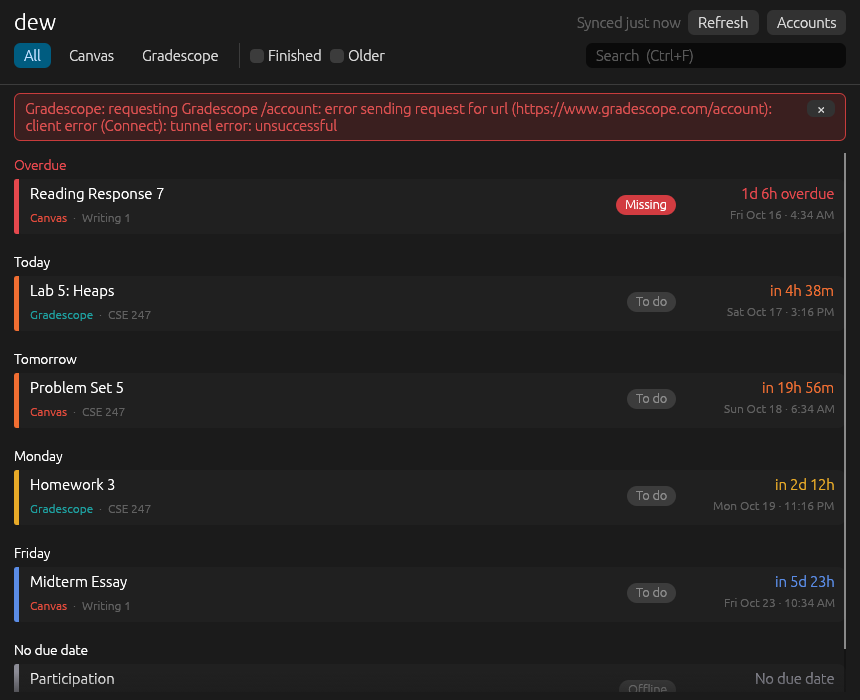

# dew

Canvas and Gradescope assignments in one list, sorted by due date. Click an assignment
to open it in your browser.



- Pulls from **Canvas** (official REST API) and **Gradescope** (scrapes the web pages,
  since there's no public API)
- Groups work by day (Overdue, Today, Tomorrow, …) and colors it by how soon it's due
- Hides finished work and items more than 14 days past due by default
- Drops Canvas copies of assignments that are really submitted on Gradescope
- Keeps the last fetch on disk, so it opens instantly and still works offline
- Also has a terminal view (`dew tui`), plain output (`dew list`), and a Waybar module
  (`dew waybar`)

## Install (Arch / CachyOS)

```sh
sudo pacman -S --needed cmake webkit2gtk-4.1
git clone https://github.com/novarie-bit/dew && cd dew/packaging/arch
makepkg -sif
```

To update later: `cd ~/dew && git pull && cd packaging/arch && makepkg -sif`. The `-f`
makes makepkg rebuild even when the version number hasn't changed. Without it, makepkg
may reinstall the package it built last time.

You also need Rust. If `cargo --version` doesn't work yet, install **either**
`rustup` (then run `rustup toolchain install stable`) **or** the `rust` package. Don't
install both, because they conflict. If pacman offers to remove `rustup`, say no.

Or without packaging it: `cargo install --path .` (puts `dew` in `~/.cargo/bin`).

## Sign in

Open dew and click **Accounts** (it opens by itself on first launch), then **Sign in with
browser** next to Canvas and next to Gradescope. A small browser window opens. Log in the
way you do on the website: WashU SSO, Duo, and on Gradescope **School Credentials** all
work. Once the site shows you're signed in, dew saves the session and the window closes.

- dew never sees or stores your password, only the site's session cookie (mode 600, in
  `~/.local/share/dew/`).
- The sign-in window keeps its own browser profile, so Duo's "remember me" and the SSO
  session carry over. When a Canvas session eventually expires, signing in again is
  usually one click.
- From a terminal: `dew login canvas` / `dew login gradescope` open the same window. In
  the terminal view's accounts screen (`L`), press `Ctrl-B` on a service's fields.

Other ways to sign in, under **Other ways to sign in** in the dialog:

- **Canvas access token**, if your school allows creating them (WashU doesn't):
  `dew login canvas --token`.
- **Gradescope email + password**, if you've set a Gradescope password:
  `dew login gradescope --password`.
- **Pasted cookies** from a browser that's already signed in (DevTools → Storage or
  Application → Cookies): `canvas_session` for Canvas, or `signed_token` and
  `_gradescope_session` for Gradescope. From a terminal, use `--cookies`.

For a school other than WashU, change the Canvas URL in the dialog, or use
`dew login canvas --url school.instructure.com`.

## Using it

In the window:

- **Click** an assignment to open it on Canvas/Gradescope. Right-click to copy the link.
- **All / Canvas / Gradescope** filter by source. **Finished** and **Older** show
  submitted work and items more than `keep_past_days` past due.
- **Ctrl+F** searches names and courses; **F5** or **Refresh** re-syncs.
- **Hide** (on hover, or right-click) removes an assignment from the list. **Hide all
  overdue** on the Overdue heading clears that whole group, with an **Undo** button.
  Tick **Hidden (n)** to see hidden items and **Restore** them. Hidden items also drop
  out of `dew list` and the Waybar count.
- A colored bar on each card shows urgency: red is overdue, orange is due within 24h,
  yellow within 3 days, blue later, green finished.

Terminal view (`dew tui`) keys:

| key | action |
| --- | --- |
| `j`/`k`, arrows | move |
| `g`/`G` | first / last |
| `Enter`, `o` | open in browser |
| `r` | refresh |
| `d` | show/hide finished work |
| `p` | show/hide items long past due |
| `x` | hide / restore the selected item |
| `X` | hide every overdue item |
| `h` | show/hide hidden items |
| `s`, `Tab` | cycle Canvas / Gradescope / all |
| `/` | search (`Esc` clears it) |
| `L` | accounts |
| `?` | help |
| `q` | quit |

Rows are red when overdue, bold red when due within 24h, and yellow when due within 3 days.

`dew` with no arguments opens the window when there's a display (`WAYLAND_DISPLAY` or
`DISPLAY`), and the terminal view otherwise, e.g. over SSH.

## CLI

```
dew                 window (or terminal view without a display)
dew gui | dew tui   pick one explicitly
dew list [-a] [--json] [--cached]
dew sync
dew waybar
dew login canvas|gradescope   [--token | --password | --cookies]
dew logout [canvas|gradescope]
dew status          sign-in state and file locations
```

## Waybar

```jsonc
"custom/dew": {
  "exec": "dew waybar",
  "return-type": "json",
  "interval": 300,
  "format": "󰃭 {}",
  "on-click": "dew gui"
}
```

The text is the number of items due in the next 7 days, including overdue ones. The
tooltip lists them, and the CSS class is `urgent`, `warning`, `normal`, or `empty`. See
`packaging/waybar/` for a style snippet. `dew waybar` only hits the network when the
cache is older than `refresh_minutes`.

## Files

| path | contents |
| --- | --- |
| `~/.config/dew/config.toml` | settings (created with defaults on first run) |
| `~/.config/dew/credentials.toml` | Canvas URL (+ token if you use one), names (mode 600) |
| `~/.local/share/dew/canvas_cookies.json` | Canvas session (mode 600) |
| `~/.local/share/dew/gradescope_cookies.json` | Gradescope session (mode 600) |
| `~/.local/share/dew/webview/` | sign-in window's browser profile |
| `~/.local/share/dew/hidden.json` | assignments you've hidden |
| `~/.cache/dew/assignments.json` | last fetch |

```toml
# config.toml
keep_past_days = 14          # keep showing items this many days after they were due
dedupe = true                # hide Canvas mirrors of Gradescope assignments
gradescope_all_terms = false # only the newest Gradescope term by default
refresh_minutes = 30         # auto-refresh interval (window, TUI, waybar)
opener = "xdg-open"          # command used to open links
theme = "system"             # window theme: "system", "light", or "dark"
```

## Notes

- The Gradescope scraper depends on Gradescope's page markup. If they change it,
  assignments might come back empty or with missing dates. The parser lives in
  `src/gradescope.rs`, with HTML fixtures in `tests/fixtures/`.
- The sign-in window is WebKitGTK (`webkit2gtk-4.1`). If it ever comes up blank, try
  `WEBKIT_DISABLE_COMPOSITING_MODE=1 dew`.
- The window uses egui with OpenGL and runs natively on Wayland (KDE, Hyprland, Sway, …)
  and X11. If it can't open a window, it says so; `dew tui` still works.
